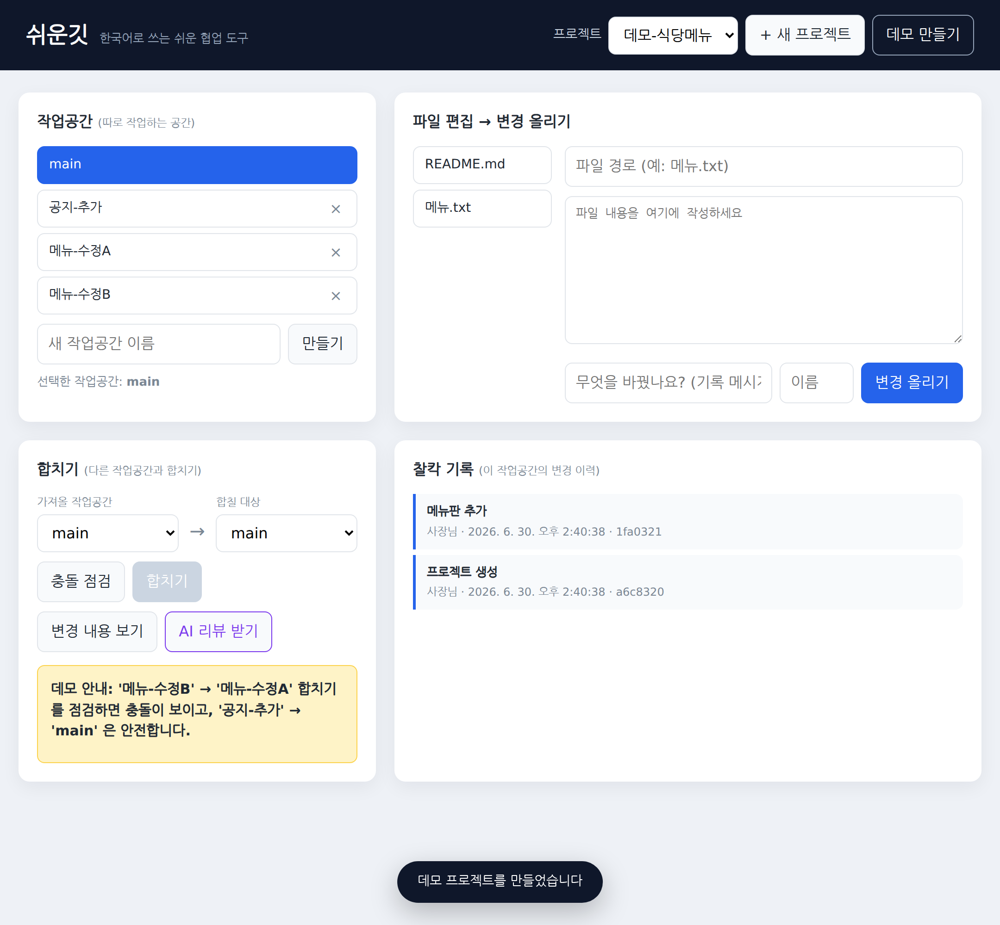
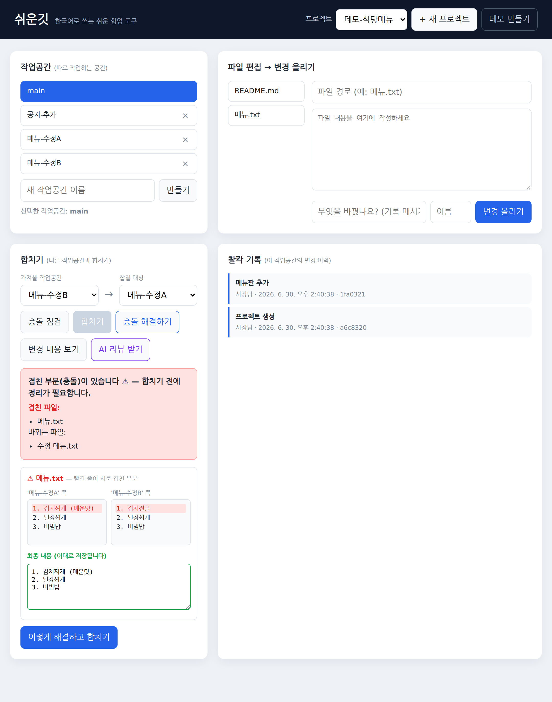

# 쉬운깃 (EasyGit)

GitHub의 협업 기능(작업공간 관리·충돌 점검·합치기)을 **한국어로, 더 쉽게** 다시 만든 도구입니다.
복잡한 영어 용어와 단계를 줄이고, 꼭 필요한 흐름만 남겼습니다.

| GitHub 용어 | 쉬운깃 용어 |
|------|------|
| Repository | 프로젝트 |
| Branch | 작업공간 |
| Commit | 찰칵(기록) |
| Merge conflict | 겹친 부분(충돌) ⚠️ |
| Merge | 합치기 |

## 화면

전체 화면:



겹친 부분(충돌)을 화면에서 직접 정리해서 합치기 — 서로 다른 줄이 빨갛게 표시됩니다:



## 구조

```
[한국어 웹 화면]  (static/index.html, app.js)
       │
[Spring Boot]   REST API — GitHub 개념을 한국어로 단순화
       │
[JGit]          실제 Git 엔진 (충돌탐지·합치기·기록). Gitea 가 내부적으로 쓰는 것과 같은 계열.
       │
[data/repos/]   각 프로젝트가 실제 Git 저장소로 저장됨
```

> 별도 서버(예: Gitea)를 띄울 필요 없이, **이 앱 하나로** 동작합니다.
> 나중에 외부 호스팅이 필요하면 JGit 자리에 Gitea 를 연동할 수 있습니다.

## 실행 방법

필요 도구: Java 17, Maven (이미 설치돼 있음)

```bash
cd /home/for_romanxe/easygit
./run.sh          # 또는:  mvn -DskipTests spring-boot:run
```

브라우저에서 접속:

```
http://localhost:8088
```

(WSL 이므로 Windows 브라우저에서도 같은 주소로 접속됩니다.)

## 사용해보기 (1분 데모)

1. 우측 상단 **[데모 만들기]** 클릭 → `데모-식당메뉴` 프로젝트가 생성됩니다.
2. **합치기** 카드에서:
   - 가져올 작업공간 `메뉴-수정B` → 합칠 대상 `메뉴-수정A` → **[충돌 점검]**
     → "겹친 부분(충돌)이 있습니다 ⚠️" (`메뉴.txt`) 가 빨갛게 표시됩니다.
   - 가져올 `공지-추가` → 합칠 대상 `main` → **[충돌 점검]**
     → "안전하게 합칠 수 있습니다 ✅" → **[합치기]** 가능.
3. **파일 편집 → 변경 올리기** 로 직접 파일을 고치고 "찰칵" 기록을 남겨보세요.

## 기능

- 프로젝트 만들기 / 선택
- 작업공간(브랜치) 목록 · 새 작업공간 만들기 · **삭제**(× 버튼, main은 보호)
- 파일 보기 · 편집 · **변경 올리기**(add + commit 통합)
- **충돌 점검** — 합치기 전에 겹친 부분을 미리 알려줌 (작업 파일을 건드리지 않음)
- **충돌 직접 해결** — 양쪽 내용을 보고(다른 줄은 빨갛게 표시) 최종 내용을 작성해 합치기
- **합치기** — 충돌나면 합치지 않고 자동 원상복구
- **변경 내용 보기** — 합치기로 바뀌는 부분을 색깔 diff(+초록/-빨강)로 표시
- **AI 리뷰** — Claude(`claude-opus-4-8`)가 변경 코드를 한국어로 리뷰 (`ANTHROPIC_API_KEY` 필요)
- **찰칵 기록**(커밋 히스토리)

## API 요약

| 메서드 | 경로 | 설명 |
|------|------|------|
| GET | `/api/projects` | 프로젝트 목록 |
| POST | `/api/projects` | 프로젝트 생성 |
| GET | `/api/projects/{p}/branches` | 작업공간 목록 |
| POST | `/api/projects/{p}/branches` | 작업공간 생성 |
| GET | `/api/projects/{p}/files?branch=` | 파일 목록 |
| GET | `/api/projects/{p}/file?branch=&path=` | 파일 내용 |
| POST | `/api/projects/{p}/commit` | 변경 올리기 |
| GET | `/api/projects/{p}/history?branch=` | 찰칵 기록 |
| DELETE | `/api/projects/{p}/branches/{name}` | 작업공간 삭제 |
| GET | `/api/projects/{p}/check-merge?from=&into=` | 충돌 점검 |
| GET | `/api/projects/{p}/conflict?from=&into=` | 충돌 파일 양쪽 내용 |
| POST | `/api/projects/{p}/resolve-merge` | 충돌 해결하며 합치기 |
| GET | `/api/projects/{p}/diff?from=&into=` | 변경 내용(diff) |
| POST | `/api/projects/{p}/merge` | 합치기 |
| GET | `/api/projects/{p}/review?from=&into=` | AI 코드 리뷰 |
| POST | `/api/demo` | 데모 데이터 생성 |

## 다음으로 확장하기 좋은 것

- 여러 사람 로그인 / 권한
- 줄 단위로 "이쪽/저쪽 선택" 버튼을 둔 더 쉬운 충돌 해결 UI
- 저장 백엔드를 JGit → 셀프호스팅 Gitea 로 교체
