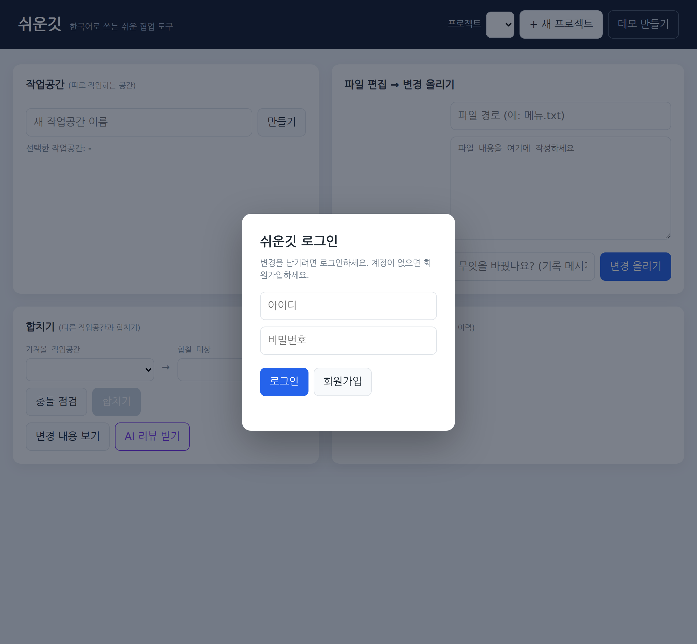
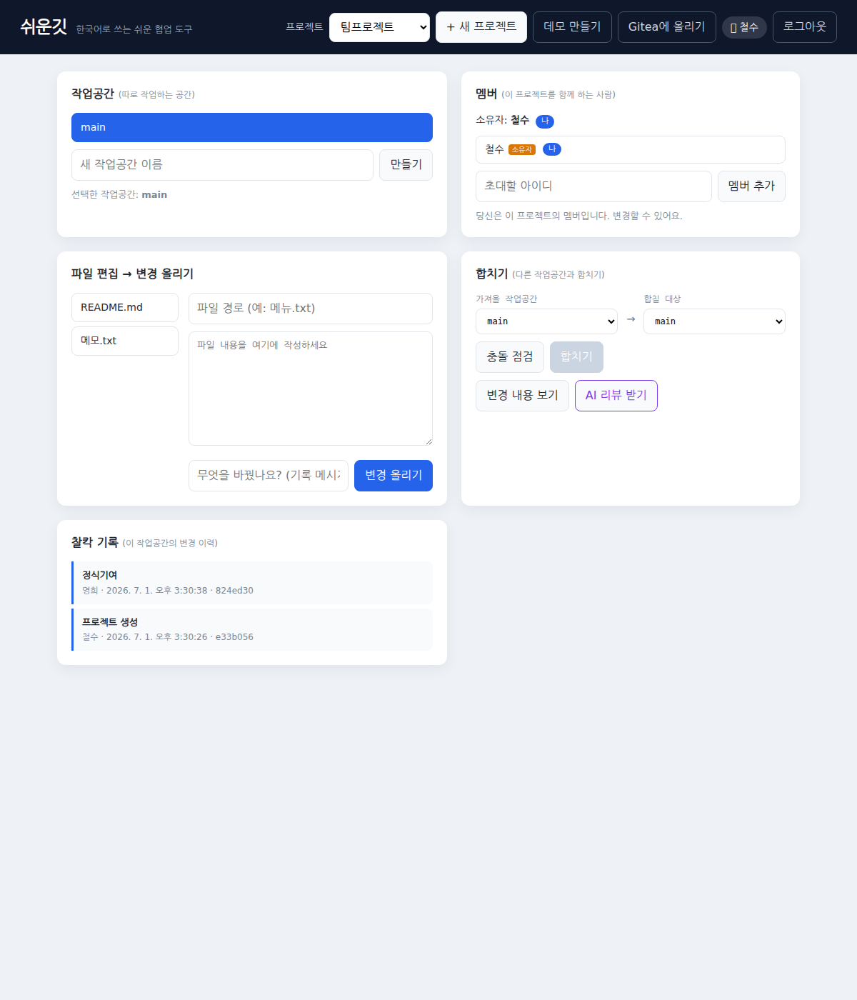
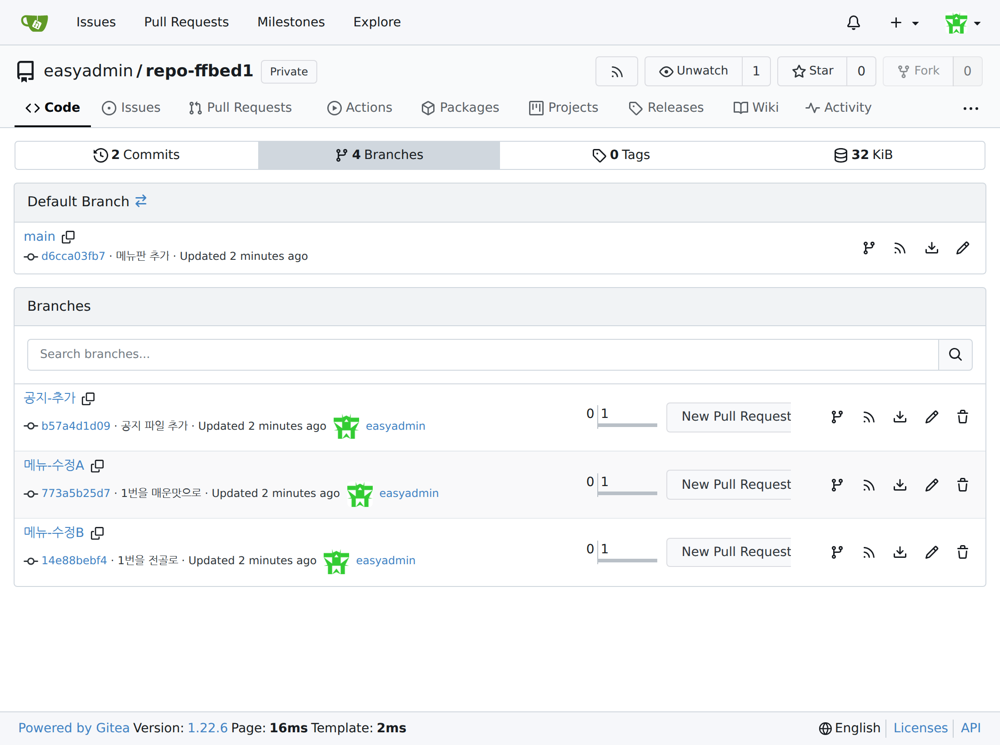

# 쉬운깃 (EasyGit)

GitHub의 협업 기능(작업공간 관리·충돌 점검·합치기)을 **한국어로, 더 쉽게** 다시 만든 도구입니다.
복잡한 영어 용어와 단계를 줄이고, 꼭 필요한 흐름만 남겼습니다.

| GitHub 용어 | 쉬운깃 용어 |
|------|------|
| Repository | 프로젝트 |
| Branch | 작업공간 |
| Commit | 찰칵(기록) |
| Merge conflict | 겹친 부분(충돌) ⚠️ |
| Merge | 합치기 |

## 화면

전체 화면:


겹친 부분(충돌)을 **줄 단위로 '이쪽/저쪽'을 골라** 해결합니다:


로그인 화면:



프로젝트를 만든 사람이 **소유자**가 되고, 소유자가 **멤버를 초대**할 수 있습니다.
멤버가 아닌 사람은 보기만 가능합니다:



멤버가 아닌 사람이 볼 때(읽기 전용):


**[Gitea에 올리기]** 버튼을 누르면 로컬에 띄운 실제 Gitea 서버로 프로젝트가 그대로 올라갑니다(아래는 Gitea 웹 화면):



## 구조

```
[한국어 웹 화면]  (static/index.html, app.js)
       │
[Spring Boot]   REST API — GitHub 개념을 한국어로 단순화
       │
[JGit]          실제 Git 엔진 (충돌탐지·합치기·기록). Gitea 가 내부적으로 쓰는 것과 같은 계열.
       │
[data/repos/]   각 프로젝트가 실제 Git 저장소로 저장됨
```

> 별도 서버(예: Gitea)를 띄울 필요 없이, **이 앱 하나로** 동작합니다.
> 나중에 외부 호스팅이 필요하면 JGit 자리에 Gitea 를 연동할 수 있습니다.

## 실행 방법

필요 도구: Java 17, Maven (이미 설치돼 있음)

```bash
cd /home/for_romanxe/easygit
./run.sh          # 또는:  mvn -DskipTests spring-boot:run
```

브라우저에서 접속:

```
http://localhost:8088
```

(WSL 이므로 Windows 브라우저에서도 같은 주소로 접속됩니다.)

## 사용해보기 (1분 데모)

1. 우측 상단 **[데모 만들기]** 클릭 → `데모-식당메뉴` 프로젝트가 생성됩니다.
2. **합치기** 카드에서:
   - 가져올 작업공간 `메뉴-수정B` → 합칠 대상 `메뉴-수정A` → **[충돌 점검]**
     → "겹친 부분(충돌)이 있습니다 ⚠️" (`메뉴.txt`) 가 빨갛게 표시됩니다.
   - 가져올 `공지-추가` → 합칠 대상 `main` → **[충돌 점검]**
     → "안전하게 합칠 수 있습니다 ✅" → **[합치기]** 가능.
3. **파일 편집 → 변경 올리기** 로 직접 파일을 고치고 "찰칵" 기록을 남겨보세요.

## 기능

- **로그인 / 회원가입** — 변경은 로그인한 사용자만 가능, 모든 기록이 그 사용자 이름으로 남음
- **멤버 / 권한** — 프로젝트를 만든 사람이 소유자가 되고, 소유자가 멤버를 초대·내보냄. **멤버만 변경 가능**, 나머지는 보기 전용. 소유자 없는(옛) 프로젝트는 "관리자 되기"로 소유권을 가져올 수 있음
- 프로젝트 만들기 / 선택
- 작업공간(브랜치) 목록 · 새 작업공간 만들기 · **삭제**(× 버튼, main은 보호)
- 파일 보기 · 편집 · **변경 올리기**(add + commit 통합)
- **충돌 점검** — 합치기 전에 겹친 부분을 미리 알려줌 (작업 파일을 건드리지 않음)
- **충돌 직접 해결** — 양쪽 내용을 보고(다른 줄은 빨갛게 표시) 최종 내용을 작성해 합치기
- **합치기** — 충돌나면 합치지 않고 자동 원상복구
- **변경 내용 보기** — 합치기로 바뀌는 부분을 색깔 diff(+초록/-빨강)로 표시
- **AI 리뷰** — Claude(`claude-opus-4-8`)가 변경 코드를 한국어로 리뷰 (`ANTHROPIC_API_KEY` 필요)
- **Gitea에 올리기** — 로컬에 띄운 **실제 Gitea 서버**에 프로젝트(모든 작업공간)를 푸시
- **찰칵 기록**(커밋 히스토리)

## API 요약

| 메서드 | 경로 | 설명 |
|------|------|------|
| GET | `/api/projects` | 프로젝트 목록 |
| POST | `/api/projects` | 프로젝트 생성 |
| GET | `/api/projects/{p}/branches` | 작업공간 목록 |
| POST | `/api/projects/{p}/branches` | 작업공간 생성 |
| GET | `/api/projects/{p}/files?branch=` | 파일 목록 |
| GET | `/api/projects/{p}/file?branch=&path=` | 파일 내용 |
| POST | `/api/projects/{p}/commit` | 변경 올리기 |
| GET | `/api/projects/{p}/history?branch=` | 찰칵 기록 |
| DELETE | `/api/projects/{p}/branches/{name}` | 작업공간 삭제 |
| GET | `/api/projects/{p}/check-merge?from=&into=` | 충돌 점검 |
| GET | `/api/projects/{p}/conflict?from=&into=` | 충돌 파일 양쪽 내용 |
| POST | `/api/projects/{p}/resolve-merge` | 충돌 해결하며 합치기 |
| GET | `/api/projects/{p}/diff?from=&into=` | 변경 내용(diff) |
| POST | `/api/projects/{p}/merge` | 합치기 |
| GET | `/api/projects/{p}/review?from=&into=` | AI 코드 리뷰 |
| POST | `/api/projects/{p}/publish` | 실제 Gitea 서버에 올리기 |
| GET | `/api/projects/{p}/members` | 멤버/권한 현황 |
| POST | `/api/projects/{p}/members` | 멤버 추가(소유자만) |
| DELETE | `/api/projects/{p}/members/{name}` | 멤버 내보내기(소유자만) |
| POST | `/api/projects/{p}/claim` | 소유자 없는 프로젝트의 관리자 되기 |
| POST | `/api/demo` | 데모 데이터 생성 |
| POST | `/api/auth/register` · `/login` · `/logout`, GET `/api/auth/me` | 로그인 |

## 실제 Gitea 연동 (선택)

"Gitea에 올리기" 기능은 로컬에 **실제 Gitea 서버**가 떠 있어야 동작합니다. 단일 바이너리로 띄웁니다.

```bash
# 1) Gitea 바이너리 받기
mkdir -p ~/gitea-bin ~/gitea-data && cd ~/gitea-bin
curl -fsSL -o gitea https://dl.gitea.com/gitea/1.22.6/gitea-1.22.6-linux-amd64
chmod +x gitea

# 2) 설치 화면을 건너뛰는 app.ini 를 ~/gitea-data/app.ini 에 작성
#    (INSTALL_LOCK=true, DB_TYPE=sqlite3, HTTP_PORT=3000 등)

# 3) 실행 → 첫 실행에서 DB 생성
GITEA_WORK_DIR=~/gitea-data ./gitea web -c ~/gitea-data/app.ini &

# 4) 관리자 + API 토큰 생성
GITEA_WORK_DIR=~/gitea-data ./gitea admin user create --admin \
  --username easyadmin --password '바꾸세요' --email easyadmin@local -c ~/gitea-data/app.ini
GITEA_WORK_DIR=~/gitea-data ./gitea admin user generate-access-token \
  --username easyadmin --raw --scopes write:repository,write:user -c ~/gitea-data/app.ini \
  > ~/gitea-data/token.txt
```

쉬운깃은 `easygit.gitea.token-file`(기본 `~/gitea-data/token.txt`) 또는 `GITEA_TOKEN` 환경변수에서 토큰을 읽습니다.
한글 프로젝트 이름은 Gitea 규칙(영문/숫자/.-_)에 맞게 자동 변환해 올립니다.

## 다음으로 확장하기 좋은 것

- 멤버별 역할 구분(읽기/쓰기/관리 권한 단계)
- 작업공간별 보호 규칙(예: main 은 소유자만 합치기 가능)
- 저장 백엔드를 JGit → 셀프호스팅 Gitea 로 교체
